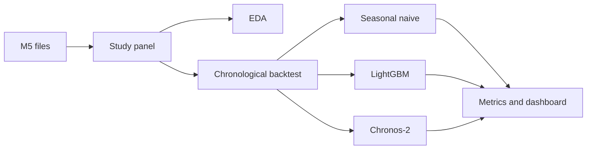

# Semester 3: retail demand forecasting

Predict daily product-store sales on a reproducible Walmart M5 subset, and
compare three forecasting methods:

1. Seasonal naive, the simple baseline.
2. LightGBM, a practical machine-learning baseline trained only on past data.
3. Chronos-2, a pretrained time-series model used zero-shot.

The study reports point accuracy and forecast uncertainty. It does not recommend
orders. Inventory replenishment is the Semester 4 extension and is not in this
project.

Research question:

> On a held-out chronological evaluation of a reproducible Walmart M5 subset,
> how does zero-shot Chronos-2 compare with a seasonal-naive baseline and a
> LightGBM model trained only on past data, in point accuracy (MAE, MASE) and
> uncertainty quality (pinball loss, prediction-interval coverage, and interval
> width)?



## What is in scope

- A repeatable data pipeline for about 120 product-store series.
- Exploratory plots of weekday seasonality and intermittent sales.
- Seasonal-naive and LightGBM baselines.
- Chronos-2 forecasts from a pretrained checkpoint.
- Four non-overlapping 28-day forecast windows.
- MAE, MASE, pinball loss, interval coverage, interval width, runtime, and memory.
- A Streamlit page for actual sales, forecasts, and the prediction interval.

## What is not in scope

- Training a neural network from scratch.
- TimesFM. It is a possible later comparator, not part of this build.
- Inventory simulation, reorder quantities, fill rate, or cost savings.
- Treating a zero-sales day as a stockout.
- Using MAPE as the primary score.

## Setup

From this folder, in PowerShell:

```powershell
python -m venv .venv
.\.venv\Scripts\Activate.ps1
python -m pip install -e ".[dev,dashboard]"
```

If activation is blocked, run `Set-ExecutionPolicy -Scope Process RemoteSigned`
once in that terminal, then activate again.

Python 3.10 or newer is required. A Java background is enough. The closest
mappings are: `pyproject.toml` is the dependency file, a `DataFrame` is the
table you operate on, and `pytest` is the test runner.

Check the pipeline without downloading M5:

```powershell
python -m demand_forecast.cli demo
python -m pytest
```

The demo writes synthetic data under `data/demo`. Its scores are only a
software check. Do not put them in the report.

## Run the M5 study

1. Create a free Kaggle account.
2. Accept the rules at <https://www.kaggle.com/competitions/m5-forecasting-accuracy/data>.
3. Either install the Kaggle CLI and run:

```powershell
python -m demand_forecast.cli download
python -m demand_forecast.cli all
```

or unzip these files into `data/raw` and run `all`:

- `sales_train_evaluation.csv`
- `calendar.csv`
- `sell_prices.csv`

`all` prepares the subset, writes EDA figures, fits the baselines, and runs
Chronos-2. The first Chronos run downloads weights from Hugging Face.

Chronos is enabled in `config/semester3.yaml`. For a baseline-only run:

```powershell
python -m demand_forecast.cli forecast --skip-chronos
```

Install the Chronos extra before a full run if it is not already installed:

```powershell
python -m pip install -e ".[chronos]"
```

The configured checkpoint is `autogluon/chronos-2-small`, so a laptop CPU can
run the subset. Change `models.chronos_model_id` to `amazon/chronos-2` only
after checking runtime and the model card. Record the exact checkpoint and
licence in the report.

Open the dashboard after a forecast run:

```powershell
streamlit run app/dashboard.py
```

The dashboard opens the available result set (preferring M5 when present) and
lets you switch between M5 and the synthetic demo. Use Forecast explorer to
filter by model, demand class, store, series, and forecast origin; use Model
comparison to review overall and demand-class scores. The chart shows the
actuals, point forecast, and interval bounds when the run includes quantiles.
The synthetic demo is clearly marked and should only be used to check the UI and
pipeline. Open the **Run a study** accordion to see buttons for the synthetic
demo, an M5 baseline run without Chronos-2, and the full M5 comparison. The M5
buttons enable only when all three source CSVs are present; the full comparison
also requires the Chronos extra to be installed. Progress and CLI output appear
in the dashboard. The Streamlit menu remains available with its other controls;
the Deploy button is hidden.

To run your own data, expand **Run a study**, select **Upload Excel workbook**
as the M5 data source, and upload one `.xlsx` workbook with three sheets:
`sales` (or `sales_train_evaluation`), `calendar`, and
`sell_prices` (or `prices`). Use the M5 column layout: the sales sheet needs
`item_id`, `dept_id`, `cat_id`, `store_id`, `state_id`, and consecutive daily
columns `d_1` through `d_N` (at least 320 days with the current backtest
settings); the calendar sheet needs `d`,
`date`, and `wm_yr_wk`; the prices sheet needs `store_id`, `item_id`,
`wm_yr_wk`, and `sell_price`. The sales sheet may contain at most 10,000 series
rows. The dashboard validates the workbook before it runs. Uploaded input and outputs are kept in separate `data/uploads/` and
`reports/uploads/` folders, so they do not replace the standard M5 run.
After a successful uploaded run, choose it from the Result set menu and open
the Uploaded data tab to view all rows from the sales, calendar, or price sheet.
For uploaded workbooks, choose either **All uploaded series** or the configured
**Research sample** before running. All-series mode includes zero-sales series
and can take substantially longer or require more memory.

## How the experiment stays honest

- The sample is chosen from the year before the first test origin, not from the
  test window. The seed is `42`.
- Requested mix: 40 fast, 40 slow, and 40 intermittent series. If a class is
  scarce, the log says so. Medium series used to fill a shortfall keep the
  label medium.
- Each LightGBM fit sees only days up to that window's origin.
- Lags and rolling statistics end at the origin. Calendar fields for the target
  day are used because the calendar is known in advance.
- Future price is not used unless `features.assume_future_price_known` is set
  to `true` and the report justifies it. The default is `false` for every model.
- Chronos cross-learning is off. Turning it on makes scores depend on which
  series share a batch, so that would be a separate experiment.
- Evaluation windows do not overlap. There is no random train/test split.
- MASE uses the seasonal scale of history before the origin. Constant series
  get a missing MASE rather than a divide-by-zero claim.
- Prediction intervals are clipped at zero and forced into quantile order.
  Sales cannot be negative.

Class thresholds live in `config/semester3.yaml`. They decide the sample, not
the model. Fix them before reading test metrics.

## Outputs

| Path | Contents |
| --- | --- |
| `data/processed/panel.parquet` | Selected series, daily sales, price, calendar |
| `data/processed/series_catalog.csv` | Class, zero rate, ADI, and Syntetos-Boylan label |
| `data/processed/forecasts.csv` | Actuals, point forecasts, and quantiles |
| `reports/eda_summary.md` | Exploratory notes |
| `reports/figures/` | Seasonality, intermittency, and MAE plots |
| `reports/experiment_summary.md` | Tables for the report |
| `reports/semester3_report_outline.md` | Chapter structure |

`peak_python_memory_mb` is memory traced inside Python. It understates Chronos
process RAM. For the model checkpoint, also note Task Manager or the operating
system monitor.

## Reading a result

Compare models within each demand class. A lower MAE is better. MASE below 1
means the model beat seasonal naive on that series. Coverage near 0.80 means
the 0.1 to 0.9 interval contains about 80% of actual sales. A narrow interval
with poor coverage is overconfident. A very wide interval can cover the actuals
without being useful.

Do not describe the result as money saved. M5 does not provide the inventory
and cost data that claim would need.

## Troubleshooting

- Kaggle returns 403: the competition rules have not been accepted, or the API
  token is missing.
- `M5 files were not found`: the three CSVs are not in `data/raw`. Use `demo`
  if you only want to test the code.
- Chronos import error: run `python -m pip install -e ".[chronos]"`.
- Chronos is slow on CPU: keep the small checkpoint, the 512-day context, and
  the 120-series subset. Do not start with all 30,490 series.
- LightGBM has no training rows: the series are shorter than `min_history_days`
  plus the horizon. This should not happen for M5 evaluation data.
- Dashboard says no forecasts: run `forecast` or `demo` first, and select the
  matching source in the sidebar.

## Project layout

```text
app/dashboard.py              Streamlit demonstration
config/semester3.yaml         Experiment settings
src/demand_forecast/          Pipeline, models, and metrics
tests/                        Leakage, metric, and pipeline tests
reports/semester3_report_outline.md
```

## Sources

- M5: <https://www.kaggle.com/competitions/m5-forecasting-accuracy/data>
- Chronos-2: <https://github.com/amazon-science/chronos-forecasting>
- Chronos-2 report: <https://arxiv.org/abs/2510.15821>

Recheck the Chronos model card before submission. Say in the report if overlap
between M5 and the model's pretraining data cannot be ruled out.
